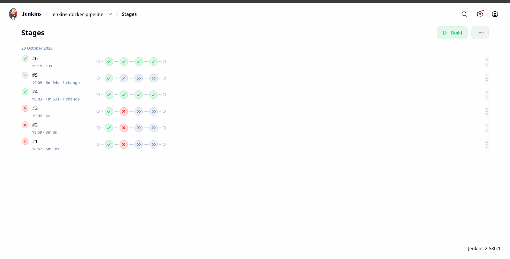

# Automated Jenkins CI/CD Pipeline with Docker & Terraform

## Overview
This repository contains the complete infrastructure and application code to deploy an automated Continuous Integration and Continuous Deployment (CI/CD) pipeline. It provisions an AWS EC2 instance using Terraform, configures it as a Jenkins server with a Docker runtime, and establishes a declarative pipeline to automatically build, test, and deploy a containerized web application upon every push to the GitHub repository.

## Architecture & Tech Stack
* **Cloud Infrastructure:** AWS EC2 (`t3.micro` on `ap-south-1`)
* **Infrastructure as Code (IaC):** Terraform
* **CI/CD Automation:** Jenkins (Declarative Pipeline)
* **Containerization:** Docker & Docker Hub
* **Version Control & Triggers:** Git, GitHub, and GitHub Webhooks
* **Application:** Static HTML served via an Nginx Alpine container

## Repository Structure
```text
.
├── Dockerfile             # Container blueprint using nginx:alpine
├── image.png              # Execution proof / Pipeline stage view screenshot
├── index.html             # Source code for the web application
├── Jenkinsfile            # Declarative pipeline with Build, Test, and Deploy stages
├── README.md              # Project documentation
└── terraform/             # IaC configuration directory
    ├── jenkins-server.tf  # EC2 instance provisioning configuration
    ├── jenkins-sg.tf      # Security group definitions (Ports 22, 80, 8080)
    ├── outputs.tf         # Terraform outputs (Public IP, Jenkins URL)
    ├── providers.tf       # AWS provider configuration
    └── userdata.sh        # Bash script to install Java, Jenkins, and Docker on boot
```

## Step-by-Step Deployment Guide

### 1. Provision Infrastructure
Ensure you have configured your AWS credentials (`aws configure`) and generated an SSH key pair locally.
```bash
cd terraform/
ssh-keygen
terraform init
terraform apply --auto-approve
```
*Terraform will output the Jenkins Dashboard URL and the EC2 Public IP upon successful completion.*

### 2. Configure the Jenkins Server
SSH into the newly provisioned instance using the generated key to retrieve the initial Jenkins administrator password:
```bash
ssh -i jenkins-server-key.pem ubuntu@<EC2_PUBLIC_IP>
sudo cat /var/lib/jenkins/secrets/initialAdminPassword
```
Access `http://<EC2_PUBLIC_IP>:8080` in your browser, paste the password, and install the suggested plugins. 

**Resource Optimization (Swap Space):**
To prevent the instance from experiencing Out-Of-Memory (OOM) freezes when Jenkins and Docker run concurrently, allocate a 2GB swap file:
```bash
sudo fallocate -l 2G /swapfile
sudo chmod 600 /swapfile
sudo mkswap /swapfile
sudo swapon /swapfile
```

### 3. Pipeline Configuration
1. In the Jenkins Dashboard, select **New Item** > **Pipeline**.
2. Under **Build Triggers**, select **GitHub hook trigger for GITScm polling**.
3. Under the **Pipeline** section, choose **Pipeline script from SCM**.
4. Set SCM to **Git**, provide the repository URL, and specify the `main` branch.
5. Ensure the Script Path is set to `Jenkinsfile` and save the configuration.

### 4. Establish the GitHub Webhook
1. Navigate to the GitHub repository **Settings** > **Webhooks**.
2. Add a new webhook with the Payload URL: `http://<EC2_PUBLIC_IP>:8080/github-webhook/`.
3. Set the Content Type to `application/json` and trigger on push events.

## CI/CD Workflow Execution
Once configured, the pipeline operates autonomously:
1. **Push:** A developer pushes code changes (e.g., updating `index.html`).
2. **Trigger:** GitHub sends a webhook payload to Jenkins.
3. **Build:** Jenkins executes the `Dockerfile` to create a new `simple-web-app:latest` image.
4. **Test:** A temporary container is spun up to verify the image successfully executes.
5. **Deploy:** The old `running-web-app` container is stopped and removed, and the new version is deployed on port 80.

## Execution Proof
